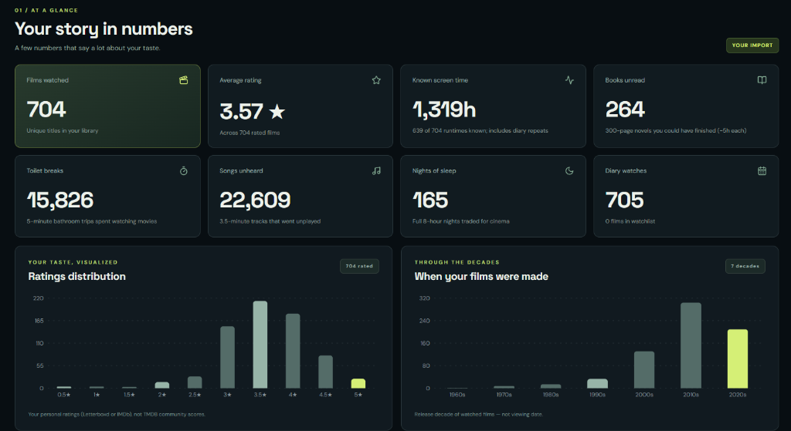
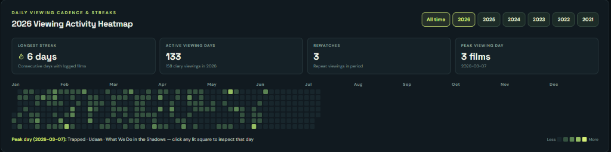
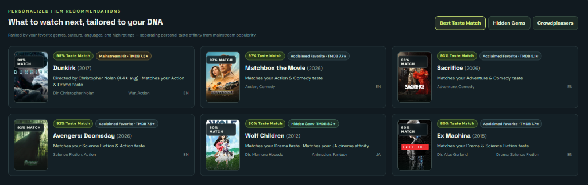
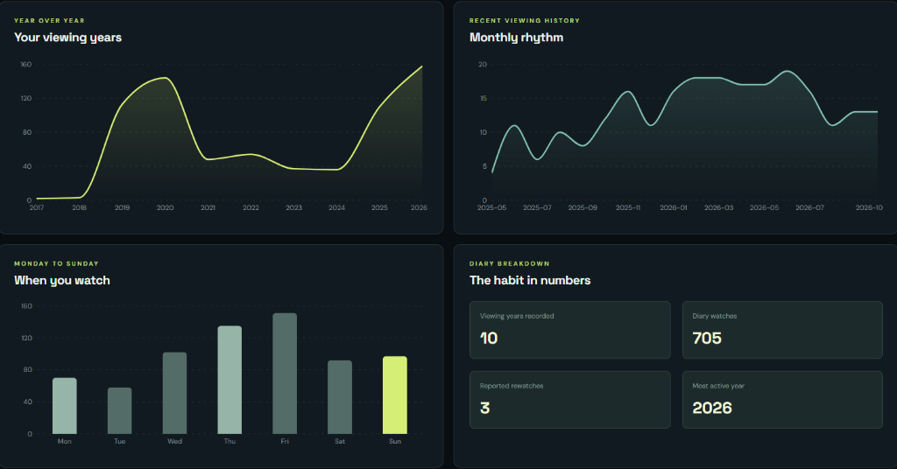

# 🎬 Frameprint — Your Cinematic DNA

[](./LICENSE)
[](https://www.typescriptlang.org/)
[](https://react.dev/)
[](https://workers.cloudflare.com/)
[](https://www.themoviedb.org/)

**Your movie history tells a story. Frameprint brings it to life.**

Frameprint transforms your Letterboxd and IMDb watching history into a beautiful, interactive analytics dashboard.
Discover your favorite directors, most-watched actors, preferred genres, viewing habits, and the films that define your cinematic taste.

---

## Features

- 📊 **Movie Analytics** — Explore ratings, viewing history, and film statistics (including playful screen-time equivalents like unread books, songs unheard, and nights of sleep).
- 🎭 **Cast & Crew Insights** — Discover your most-watched directors, actors, writers, cinematographers, composers, interactive filmmaker profiles, and creative collaborations.
- 🌍 **Cinematic DNA** — Understand your favorite genres, languages, countries, decades, and personalized film recommendations (separating personal **Taste Match %** from mainstream popularity and hidden gems).
- 📅 **Watching Timeline** — Visualize your movie-watching journey with a year-by-year global filter, daily viewing activity heatmap, streaks, and day-of-week habits.
- 🎞️ **Movie Wrapped** — Generate a personalized, multi-slide shareable summary in Instagram Story (`9:16`), Classic Portrait (`4:5`), or Square (`1:1`) formats.
- 🔒 **Privacy First** — Analyze your exported files locally in your browser, with optional browser-local `IndexedDB` persistence (`Save on this device`).

---

## Get Started

### 👉 [**Try Frameprint**](https://nimda6720.github.io/frameprint/)

Export your Letterboxd data (or IMDb ratings/lists CSV), upload the ZIP or CSV files to Frameprint, and explore your cinematic universe.
No sign-up required.

---

## Screenshots

### 01 · At a Glance & Ratings Distribution


### 02 · Daily Viewing Activity Heatmap & Streaks


### 03 · Personalized Film Recommendations


### 04 · Watching Timeline & Habits


---

## Privacy & Security

Frameprint is designed so your personal archive remains yours:

- **Local In-Browser Parsing:** Your Letterboxd `.zip` archive, individual Letterboxd `.csv` files (`watched.csv`, `ratings.csv`, `diary.csv`, `watchlist.csv`, `likes/films.csv`), and IMDb `.csv` exports are parsed locally inside a dedicated browser Web Worker.
- **What Stays on Your Device:** Your personal ratings, diary dates, rewatch counts, watchlist items, and raw CSV files are **never uploaded** to any server. If you enable **Save on this device**, your parsed library is stored solely in your browser's local `IndexedDB` and can be deleted at any time via **Delete my local data**.
- **TMDB Metadata Matching:** Only film titles and release years (`{ key, title, year }`) are sent to the Frameprint Cloudflare Worker proxy to fetch public movie metadata (posters, runtime, genres, cast, and crew) from TMDB. The TMDB API token is kept strictly server-side as an encrypted Cloudflare Worker Secret.
- **Decompression & Input Hardening:** Streaming ZIP inflation enforces strict byte, entry, and row limits to protect against malformed files and ZIP bombs.

For full technical details and vulnerability reporting instructions, see [**SECURITY.md**](./SECURITY.md).

---

## Local Development

Requires **Node.js 24+** and **pnpm 11.25.0**:

```sh
pnpm install --frozen-lockfile
pnpm dev                 # Start local Vite dev server
pnpm test                # Run frontend unit & archive safety tests (Vitest)
pnpm --dir worker test   # Run Cloudflare Worker unit tests
pnpm typecheck           # Run TypeScript type checking
pnpm build               # Build production Vite bundle
pnpm test:e2e            # Run desktop & mobile Playwright E2E tests
```

To connect local development to a deployed metadata Worker, create `.env.local`:

```ini
VITE_API_BASE_URL=https://frameprint-api.frameprint-worker.workers.dev
```

*(Never place `TMDB_READ_TOKEN` in any `VITE_*` variable or frontend file; it belongs only in Cloudflare Worker secrets via `pnpm --dir worker exec wrangler secret put TMDB_READ_TOKEN`.)*

---

## Contributing

Contributions, bug reports, and feature ideas are welcome! Please read [**CONTRIBUTING.md**](./CONTRIBUTING.md) for guidelines on reporting issues, setting up the project, and submitting pull requests.

---

## License & Attribution

Licensed under the [**MIT License**](./LICENSE).

Built with React, TypeScript, Vite, and Cloudflare Workers. Movie metadata powered by [TMDB](https://www.themoviedb.org/).
Frameprint is not affiliated with Letterboxd, IMDb, or TMDB.
